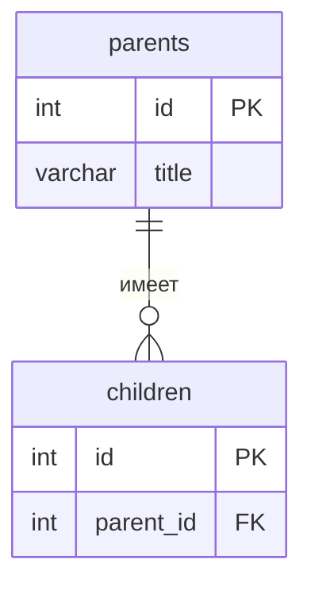

# Ветклиника — API питомцев

Тема №19: **Ветклиника**. 
API для ведения карточек питомцев: добавление, просмотр, редактирование и удаление записей. Помогает клинике вести учёт пациентов и их записей к врачу.

| | |
| --- | --- |
| Главная сущность | Питомец |
| Связанная сущность (1:N) | Визит |
| Стек | Python 3, Flask |

## Как запустить

```bash
git clone https://github.com/Moigh/backend-isaeva-vet
cd backend_isaeva_vet
python -m venv .venv
//Set-ExecutionPolicy -Scope Process -ExecutionPolicy Bypass
.venv\Scripts\activate
pip install -r requirements.txt
python main.py
```

Сервис работает на `http://localhost:8000`. Запросы для демонстрации лежат в `requests.http`.

## Эндпоинты

| Метод | Путь | Что делает | Ответ |
| --- | --- | --- | --- |
| GET | `/health` | Проверка, что сервис жив | 200 `{"status":"ok"}` |
| POST | `/api/pets` | Создать | 201 и объект с `id`; 400 при ошибке |
| GET | `/api/pets` | Список | 200 |
| GET | `/api/pets/{id}` | Получить одну запись | 200; 404 |
| PATCH | `/api/pets/{id}` | Изменить | 200; 400; 404 |
| DELETE | `/api/pets/{id}` | Удалить | 204; 404 |

## ER-диаграмма

<!-- С лабы 2. Блок mermaid GitHub рисует сам. -->



## Интерфейс

<!-- С лабы 4: скриншот, например  -->
