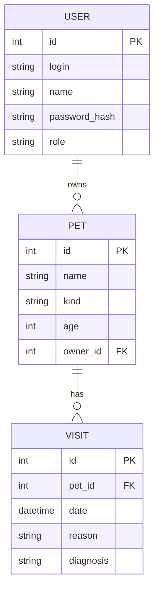

# Ветклиника — API питомцев

Тема №19: **Ветклиника**. 
API для ведения карточек питомцев: добавление, просмотр, редактирование и удаление записей. Помогает клинике вести учёт пациентов и их записей к врачу.

| | |
| --- | --- |
| Главная сущность | Питомец |
| Связанная сущность (1:N) | Визит |
| Стек | Python 3, Flask |

## Как запустить

```bash
git clone https://github.com/Moigh/backend-isaeva-vet
cd backend-isaeva-vet
python -m venv .venv
.venv\Scripts\activate
pip install -r requirements.txt
python main.py
```

Сервис работает на `http://localhost:8000`. Запросы для демонстрации лежат в `requests.http`.

## Эндпоинты

| Метод | Путь | Что делает | Ответ |
| --- | --- | --- | --- |
| GET | `/health` | Проверка, что сервис жив | 200 `{"status":"ok"}` |
| POST | `/auth/register` | Регистрация | 201; 409 если логин занят |
| POST | `/auth/login` | Получить JWT | 200 `{"access_token":"..."}`; 401 |
| GET | `/auth/me` | Текущий пользователь | 200; 401 |
| POST | `/api/pets` | Создать питомца | 201; 400; 401 |
| GET | `/api/pets` | Список питомцев | 200 |
| GET | `/api/pets/{id}` | Получить одного | 200; 404 |
| PATCH | `/api/pets/{id}` | Изменить | 200; 400; 401; 403; 404 |
| DELETE | `/api/pets/{id}` | Удалить | 204; 401; 403; 404 |
| GET | `/api/pets/{id}/visits` | Визиты питомца | 200; 404 |
| POST | `/api/pets/{id}/visits` | Создать визит | 201; 400; 401; 403; 409 |
| GET | `/api/pets/stats` | Визиты по месяцам | 200 |

## ER-диаграмма

<!-- С лабы 2. Блок mermaid GitHub рисует сам. -->



## Индекс

Индекс `ix_visit_pet_id` на `visit.pet_id` (создан миграцией).

Запрос:
```sql
SET enable_seqscan = off;
EXPLAIN SELECT * FROM visit WHERE pet_id = 1;
\\для маленького кол-ва данных
```

## Интерфейс

<!-- С лабы 4: скриншот, например  -->
